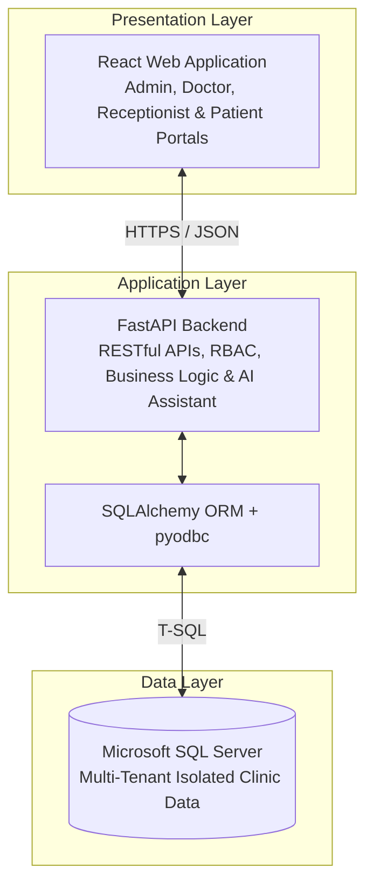

<div align="center">

# Clinova

### Smart Clinic & Queue Management Platform

**Smarter Clinics. Better Patient Flow.**


</div>

---

## Overview

**Clinova** is a web-based clinic management platform designed to digitize and streamline clinical operations through centralized patient, doctor, appointment, medical record, and real-time queue management. Built as a multi-tenant B2B SaaS solution, it bridges the gap between administrative efficiency and seamless patient experiences.

### Project Information

| Attribute          | Details                   |
| :----------------- | :------------------------ |
| **Project Type**   | BIS Graduation Project    |
| **Business Model** | B2B SaaS                  |
| **Team Leader**    | Mohamed Galal             |
| **Team Size**      | 6 Members                 |
| **Duration**       | 14 Nov 2026 – 29 May 2027 |
| **Methodology**    | SDLC with Agile Scrum     |
| **Current Phase**  | `Planning`                |

---

## Table of Contents

- [Problem Statement](#problem-statement)
- [Objectives](#objectives)
- [Core Features](#core-features)
- [Business Model](#business-model)
- [System Architecture](#system-architecture)
- [Technology Stack](#technology-stack)
- [Repository Structure](#repository-structure)
- [Development Methodology & Timeline](#development-methodology--timeline)
- [Project Management & Current Status](#project-management--current-status)
- [Team Members](#team-members)

---

## Problem Statement

Traditional clinic management relies heavily on manual, fragmented workflows, resulting in prolonged patient waiting times, scheduling conflicts, disorganized waiting rooms, and inefficient medical record handling. **Clinova** addresses these bottlenecks through an integrated digital platform that optimizes daily clinic operations and elevates the end-to-end patient journey.

---

## Objectives

- **Digitize Operations:** Transition paper-based workflows and medical records into a centralized digital ecosystem.
- **Optimize Scheduling & Flow:** Streamline appointment booking and real-time patient queue tracking.
- **Minimize Delays & No-Shows:** Reduce waiting times and missed appointments via automated notifications and self-service check-ins.
- **Enable Data-Driven Decisions:** Deliver actionable analytical insights and operational performance reports.
- **Enforce Data Security:** Guarantee strict privacy, multi-tenant isolation, and role-based access to sensitive patient records.
- **Enhance Patient Engagement:** Provide 24/7 AI-powered assistance for patient inquiries and booking support.

---

## Core Features

1. **Appointment & Doctor Management:** Centralized management of doctor availability, schedules, bookings, rescheduling, and cancellations.
2. **Automated Reminders:** Scheduled notifications sent to patients to minimize no-show rates.
3. **Real-Time Queue Management:** Digital ticket generation with live queue position and status tracking.
4. **QR Code Check-In:** Contactless patient attendance registration via instant QR code scanning.
5. **Digital Medical Records (EMR):** Structured creation, storage, and retrieval of patient medical histories.
6. **Analytics Dashboards:** Interactive visualizations tracking patient volume, attendance/absence rates, average waiting times, and doctor performance.
7. **Operational Reports:** Exportable reporting tools for evaluating overall clinic efficiency and resource utilization.
8. **Role-Based Access Control (RBAC):** Granular authentication and authorization policies tailored for administrators, doctors, receptionists, and patients.
9. **AI-Powered Assistant:** Intelligent virtual assistant capable of answering patient inquiries and assisting with appointment scheduling.


---

## Business Model

Clinova operates on a **B2B SaaS (Software-as-a-Service)** model targeting private clinics, independent medical practices, and small-to-medium healthcare facilities.

- **Value Proposition:** Simplifies clinic administration, accelerates patient throughput, reduces operational overhead, and empowers healthcare providers with data-driven insights—all within a unified, scalable cloud platform.

---

## System Architecture

Clinova implements a **Three-Layer Architecture** engineered with **multi-tenancy** in mind to guarantee strict logical data isolation across subscribed clinics:



1. **Presentation Layer:** A responsive, role-specific single-page application built with React.
2. **Application Layer:** A high-performance Python/FastAPI backend managing RESTful endpoints, authentication, business logic, queue orchestration, and AI integrations.
3. **Data Layer:** Microsoft SQL Server providing reliable relational storage with tenant-level data isolation.

---

## Technology Stack

| Category                       | Technology / Tool                     |
| :----------------------------- | :------------------------------------ |
| **Frontend**                   | React, JavaScript, HTML, CSS |
| **Backend**                    | Python, FastAPI                       |
| **Database**                   | Microsoft SQL Server                  |
| **ORM & Database Driver**      | SQLAlchemy, `pyodbc`                  |
| **Data Analytics**             | Excel, Power BI, Python, Chart.js     |
| **API Testing**                | Postman                               |
| **UI/UX Design**               | Figma                                 |
| **System Modeling & Diagrams** | diagrams.net                          |
| **Version Control**            | Git & GitHub                          |
| **Project Management**         | Jira                                  |

---

## Repository Structure

```text
clinova/
├── docs/
│   ├── 01-planning/          # System Request, Feasibility Study, Project Plan
│   ├── 02-analysis/          # SRS, Use Cases, Process & Data Models
│   ├── 03-design/            # Architecture, UI/UX Specs, DB Schema Design
│   └── 04-implementation/    # Deployment Guides, User Manuals, Transition Docs
├── diagrams/
│   ├── uml/                  # Use Case, Class, Sequence, and Activity Diagrams
│   ├── dfd/                  # Context & Leveled Data Flow Diagrams
│   ├── erd/                  # Entity-Relationship Diagrams
│   └── architecture/         # System & Multi-Tenant Architecture Diagrams
├── assets/
│   ├── images/               # Mockups, Screenshots, Presentation Media
│   └── logos/                # Brand Identity & Visual Assets
├── src/
│   ├── backend/              # FastAPI Application, Models, Schemas, Services
│   └── frontend/             # React Application, Components, Pages, Hooks
├── database/
│   ├── scripts/              # DDL/DML SQL Scripts
│   ├── migrations/           # Schema Versioning & Migration Files
│   └── seed-data/            # Mock & Initial Lookup Data
├── tests/                    # Unit, Integration, and API Test Suites
├── .gitignore
└── README.md
```

---

## Development Methodology & Timeline

The project follows the **Systems Development Life Cycle (SDLC)** integrated with **Agile Scrum** practices, structured according to _Systems Analysis and Design (5th Edition)_ by Roberta M. Roth.

| Phase                 | Period               | Key Deliverables                                                                           |
| :-------------------- | :------------------- | :----------------------------------------------------------------------------------------- |
| **1. Planning**       | 14 Nov – 28 Nov 2026 | System Request, Feasibility Study, Project Plan                                            |
| **2. Analysis**       | 28 Nov – 26 Dec 2026 | Requirement Definition, Use Cases, Process Model (DFD), Data Model (ERD)                   |
| **3. Design**         | 23 Jan – 27 Feb 2027 | Alternative Matrix, Architecture Design, UI/UX Design, Program Design, Data Storage Design |
| **4. Implementation** | 27 Feb – 29 May 2027 | System Development, Testing, Deployment, Transition to the New System                      |

---

## Team Members

| Name                 | Role                          |
| :------------------- | :---------------------------- |
| **Mohamed Galal**    | Team Leader, Business Analyst |
| **Mahmoud Moustafa** | Backend Developer             |
| **Mahmoud Nady**     | Backend Developer             |
| **Ahmed Hamdy**      | Frontend Developer            |
| **Mahmoud Khaled**   | UI/UX Designer                |
| **Mira Nagy**        | UI/UX Designer                |

---

<div align="center">
  <strong>Clinova</strong> — <em>Smarter Clinics. Better Patient Flow.</em>
</div>
